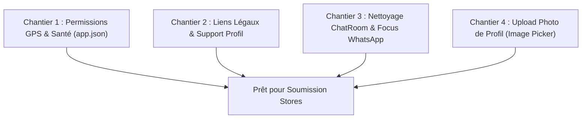

# 🚀 Feuille de Route & Spécifications MVP — RunHub / Jump-In (2026)

> **Projet :** Plateforme communautaire et tracker pour coureurs et sportifs (Dakar & Sénégal).  
> **Architecture :** Monorepo / Workspaces doubles :  
> - **Backend :** `jump-in` (NestJS 11 · Prisma 7 · PostgreSQL / Neon)  
> - **Mobile :** `runhub` (React Native 0.88 · Expo SDK 58 · Expo Router)  
> **Dernière mise à jour :** 31 Octobre 2026  

---

## 🎯 1. Périmètre & Philosophie du MVP

L'objectif de cette version MVP est de livrer une **application mobile fluide, robuste et prête pour les stores (Apple App Store & Google Play)**, adaptée aux réalités du terrain au Sénégal :
1. **Zéro fonctionnalité factice (No mock dead-ends)** : Tout ce qui est cliquable dans l'application doit être pleinement fonctionnel.
2. **Décision Actée — Exclusion du ChatRoom in-app** :
   - *Motif :* L'application s'appuie déjà sur les liens de groupes officiels **WhatsApp** (`whatsappGroupUrl`) présents sur chaque événement et club.
   - Dans le contexte local, WhatsApp est déjà le canal réflexe de discussion sportive. Développer et maintenir une messagerie instantanée propriétaire pour la V1 est redondant et complexe sans valeur ajoutée immédiate.
   - Les fichiers du chat existants restent archivés sans polluer le parcours utilisateur.
3. **Simplicité & Focus** : Trois piliers majeurs dans la navigation :
   - **🧭 Explorer** : Découvrir des événements et des clubs (vue liste + toggle carte interactive).
   - **➕ Créer** : Publier une sortie sportive ou fonder un club.
   - **🏃 Courir** : Tracker GPS en direct (allure, distance, dénivelé, auto-pause et alertes haptiques).

---

## 📊 2. Matrice d'État des Lieux du Projet

| Module / Fonctionnalité | Statut Actuel | Diagnostic & Prochaines Actions | Priorité MVP |
| :--- | :---: | :--- | :---: |
| **Auth & Sécurité** | ✅ 100% Opérationnel | Google Sign-In, Apple Sign-In, OTP e-mail sans mot de passe (Resend). | Terminée |
| **Suppression de compte** | ✅ 100% Opérationnel | Suppression définitive du compte et cascade BDD complète (RGPD / Apple 5.1.1(v)). | Terminée |
| **Navigation & Ergonomie** | ✅ 100% Opérationnel | Navigation cible épurée (Explorer, Créer, Courir). Agenda déporté dans Profil. | Terminée |
| **Découverte (Explorer)** | ✅ 100% Opérationnel | Filtres par sport, recherche, bascule dynamique Liste / Carte MapLibre. | Terminée |
| **Billetterie Gratuite** | ✅ 100% Opérationnel | Inscription en 1 tap, QR code unique, scanner caméra organisateur. | Terminée |
| **Tracker GPS (Courir)** | ✅ 95% Opérationnel | Moteur GPS, polyline, auto-pause, alertes haptiques, Apple Santé / Health Connect. | 🔴 Permissions à fixer |
| **Gestion des Clubs** | ✅ 90% Opérationnel | Création, rôles (Owner/Admin/Member), validation adhésions, lien WhatsApp. | Terminée |
| **ChatRoom In-App** | ❌ Exclu du MVP | Remplacé par les groupes WhatsApp officiels. À masquer des barres d'action. | 🟠 Nettoyage |
| **Conformité Stores (Légal)** | ⏳ Partiel | Boutons CGU / Confidentialité et Support encore vides dans le Profil. | 🔴 Obligatoire Store |
| **Photo de Profil (Avatar)** | ⏳ Partiel | Bouton "Changer de photo" non connecté à la caméra/galerie. | 🟡 Confort UX |
| **Billetterie Payante (Wave)** | ⏳ Architecture prête | Schéma BDD prêt (`payments.prisma`). Choix à arbitrer pour le MVP (voir §3). | 🔵 Arbitrage Produit |

---

## ⚖️ 3. Arbitrage Stratégique : Billetterie Gratuite vs Payante

Deux options s'offrent pour la mise sur le marché :

### Option A (Fortement Recommandée) : MVP 100% Accès Libre & Gratuit
* **Concept** : Toutes les sessions, rassemblements de running et entraînements clubs sont gratuits pour le lancement.
* **Avantages** :
  * **Acquisition fulgurante** : Aucun frein au paiement, adoption maximale par les clubs et coureurs de Dakar (Plateau, Corniche, Almadies, etc.).
  * **Zéro dépendance administrative** : Pas de blocage lié à la validation de comptes marchands ou contrats Wave / banques locales.
  * **Fiabilité maximale** : Les inscriptions sont confirmées à 100% sans risque d'échec de paiement.
* **Mise en œuvre technique** : Verrouiller ou masquer le champ prix dans [`CreationScreen.tsx`](file:///c:/Users/musad/OneDrive/Bureau/projet-perso/runhub/src/features/creation/screens/CreationScreen.tsx) et indiquer "Gratuit" sur les cartes d'événements.

### Option B : Intégration du Paiement Mobile Money (Wave / Orange Money)
* **Concept** : Permettre dès la V1 aux organisateurs de vendre des tickets payants.
* **Mise en œuvre technique requise** :
  1. Implémenter le module `payments` dans `jump-in` (API Wave Checkout ou agrégateur PayTech).
  2. Gestion des webhooks sécurisés et idempotents pour passer les inscriptions de `PENDING` à `PAID`.
  3. Intégration du composant de paiement Mobile Money dans `runhub`.

---

## 🛠️ 4. Les 4 Chantiers Prioritaires Immédiats

### 📌 Chantier 1 : Permissions Matérielles & OS (`runhub/app.json`)
* **Problème** : Le tracker de course utilise `expo-location`, mais les autorisations système manquent dans `app.json`.
* **Actions à mener** :
  1. Ajouter le plugin `expo-location` dans la section `plugins` de `app.json`.
  2. Ajouter dans `ios.infoPlist` :
     - `NSLocationWhenInUseUsageDescription` : `"RunHub a besoin de votre localisation pour mesurer précisément votre distance parcourue, votre allure et tracer votre parcours de course."`
     - `NSLocationAlwaysAndWhenInUseUsageDescription` : `"RunHub enregistre votre itinéraire pendant que l'écran est verrouillé ou que l'application est en arrière-plan."`
  3. Ajouter dans `android.permissions` :
     - `android.permission.ACCESS_FINE_LOCATION`
     - `android.permission.ACCESS_COARSE_LOCATION`
     - `android.permission.FOREGROUND_SERVICE_LOCATION`

---

### 📌 Chantier 2 : Conformité Légale & Support (Validation Apple / Google)
* **Problème** : Apple refuse systématiquement la soumission d'une application dont les liens de Politique de Confidentialité ou de Support sont inactifs.
* **Actions à mener** :
  1. **Conditions & Confidentialité** :
     - Dans [`ProfileScreen.tsx`](file:///c:/Users/musad/OneDrive/Bureau/projet-perso/runhub/src/features/profile/screens/ProfileScreen.tsx), brancher la ligne `termsAndPrivacy` avec `WebBrowser.openBrowserAsync('https://runhub.app/legal/privacy')` (ou ouvrir une modal/écran de synthèse des règles de confidentialité).
  2. **Aide & Contact** :
     - Brancher `helpAndContact` pour ouvrir le client e-mail vers `contact@musatech.tech` avec `Linking.openURL('mailto:contact@musatech.tech?subject=Support%20RunHub')`.

---

### 📌 Chantier 3 : Nettoyage du ChatRoom & Focus WhatsApp
* **Problème** : La barre d'action [`EventBottomBar.tsx`](file:///c:/Users/musad/OneDrive/Bureau/projet-perso/runhub/src/features/events/components/event-bottom-bar.tsx) affiche encore une bulle de chat générique avec un point de notification même sans groupe.
* **Actions à mener** :
  1. Si `hasWhatsApp` est vrai (`event.whatsappGroupUrl`), afficher fièrement le bouton WhatsApp avec son logo officiel vert.
  2. Si `hasWhatsApp` est faux, ne pas afficher de fausse icône de chat afin d'éviter toute confusion.
  3. Conserver la route [`runhub/src/app/chat/[id].tsx`](file:///c:/Users/musad/OneDrive/Bureau/projet-perso/runhub/src/app/chat/[id].tsx) inactive sans lien d'accès direct dans l'interface.

---

### 📌 Chantier 4 : Upload d'Avatar dans l'Édition du Profil
* **Problème** : Dans [`EditProfileScreen.tsx`](file:///c:/Users/musad/OneDrive/Bureau/projet-perso/runhub/src/features/profile/screens/EditProfileScreen.tsx), le tap sur "Changer de photo" ne déclenche rien.
* **Actions à mener** :
  1. Utiliser `expo-image-picker` pour permettre de choisir une photo depuis la bibliothèque ou de prendre un selfie.
  2. Envoyer le fichier vers l'API d'upload de `jump-in` (`POST /upload/presigned-url` ou upload direct multipart).
  3. Enregistrer l'URL de l'avatar dans `user.avatarUrl`.

---

## 📱 5. Checklist de Déploiement & Release Stores (Expo EAS)

Avant la génération des builds de test :
- [ ] **Identifiants App Store & Play Store** :
  - Bundle Identifier : `com.musadiagnesorganization.runhub`
  - Version : `1.0.0` (Build 1)
- [ ] **Assets graphiques vérifiés** :
  - Icône de l'application (`assets/images/icon.png`)
  - Écran de démarrage Splash Screen (`assets/images/splash-icon.png`)
- [ ] **Fichier `eas.json` configuré** :
  - Profil `preview` pour builds internes APK (Android) et simulateur iOS.
  - Profil `production` pour Google Play AAB et Apple TestFlight.
- [ ] **Variables d'environnement de production** :
  - `EXPO_PUBLIC_API_URL` pointant vers le serveur backend NestJS de production.

---

## 📋 6. Prochaines Étapes Opérationnelles Recommandées

1. **Valider le choix Option A (MVP Gratuit)** pour verrouiller le formulaire de création et sécuriser un parcours sans accroc.
2. **Appliquer les Chantiers 1, 2, 3 et 4** dans `runhub`.
3. **Tester sur appareil physique (Expo Go / Development Build)** le GPS, la création d'événement et le flux WhatsApp.
4. **Générer le premier build de production via EAS**.

